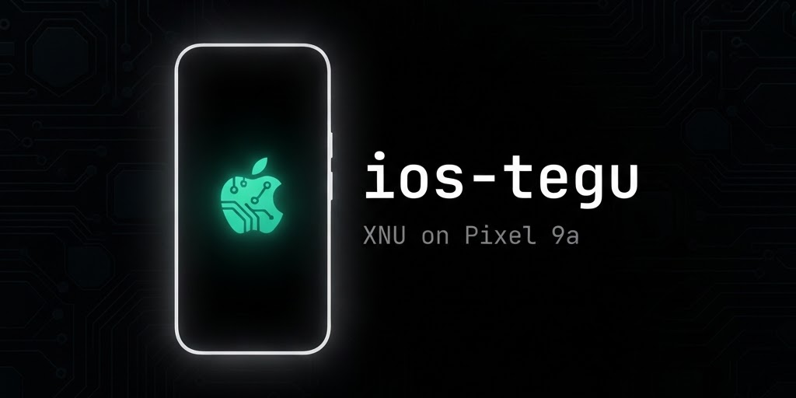

<p align="center">
  
</p>

<h1 align="center">ios-tegu</h1>

<p align="center">
  <b>Apple's iOS 16 running on the Google Pixel 9a.</b><br>
  The XNU kernel and the unmodified iPhone userland, ported to Tensor hardware.
</p>

<p align="center">
  <a href="https://github.com/LeR33/ios-tegu/actions/workflows/verify.yml"></a>
  <a href="https://github.com/LeR33/ios-tegu/actions/workflows/xnu.yml"></a>
  <a href="https://github.com/LeR33/ios-tegu/releases"></a>
  <a href="https://github.com/LeR33/ios-tegu/stargazers"></a>
</p>

---

> This is a port of [dipa-studio/ios-sweet](https://github.com/dipa-studio/ios-sweet)
> (iOS 16 on a Redmi Note 10 Pro) to the Pixel 9a (`tegu`, Google Tensor G4):
> the same XNU patch series, shim architecture and iOS root image pipeline,
> with tegu's register map confirmed from the stock **CP3A.260905.009** firmware.
> Experimental research project — **not a usable phone OS**.

> - [Status](#-status) · [Target](#-target) · [How it will boot](#-how-it-will-boot)
> - [Build](#-build-github-actions-no-linux-pc-needed) · **[Installation](#-installation)** · [Repository layout](#-repository-layout)

## 📋 Status

**The kernel compiles green; nothing has run on a device yet.**

| Milestone | State |
|---|---|
| M1 — CI builds XNU for tegu | ✅ **done** ([v0.1.0-m1](https://github.com/LeR33/ios-tegu/releases/tag/v0.1.0-m1)) |
| M2 — shim runs on hardware | 🔜 next ([tracking issue](https://github.com/LeR33/ios-tegu/issues/6) · [phone runbook](docs/HARDWARE-SESSION.md)) |
| M3 — XNU boots to a prompt | ⏳ planned |
| M4 — framebuffer console | ⏳ planned |
| M5 — UFS + HFS+ root + iOS image | ⏳ planned |
| M6 — touch, SpringBoard | ⏳ planned |

`kernel.development.tegu` (ARM64 Mach-O, 17.2 MB) is rebuilt on every push by
GitHub Actions — no local toolchain needed. The full 81-patch series is
proven to apply cleanly (`--fuzz=0`) on xnu-8796.141.3.

## 🎯 Target

| Item | Value |
|---|---|
| Device | Google Pixel 9a (`tegu`), 128 GB |
| SoC | Tensor G4 (`zumapro`): 1× X4 + 3× A720 + 4× A520, PSCI 1.0 |
| Memory | 8 GB @ `0x80000000` |
| Interrupts | GICv3 — GICD `0x10400000`, GICR `0x10440000` |
| Timer | 24.576 MHz generic timer |
| Storage | UFS, `samsung,exynos-ufs` @ `0x13200000` (own driver planned) |
| Panel | 1080×2406, presented to iOS as an iPhone X panel |
| Stock firmware ref. | Android 17, CP3A.260905.009, kernel 6.6 |
| iOS userland | iPhone X (iPhone10,3 / D22AP) **16.7.16 (20H392)**, unmodified |

All hardware values above were confirmed from the stock device trees
(extracted by the `ota` workflow — see `NOTES.md`).

## 🔄 How it will boot

```
BootROM → ABL → `fastboot boot` shim-boot.img   (temporary, nothing flashed)
                │
                ▼
        shim: own MMU setup, reads the live FDT,
              loads the payload from the ramdisk
                │
                ▼
        XNU Mach-O + generated Apple Device Tree + boot-args
                │
                ▼
        UFS driver → HFS+ root in userdata → dyld + shared cache
                │
                ▼
        launchd → backboardd + SpringBoard → 🍏
```

## 🚀 Build (GitHub Actions, no Linux PC needed)

Fork the repo, then from any machine with the GitHub CLI:

```bash
gh workflow run verify.yml -R YOU/ios-tegu    # ~3 min: all 81 patches apply to xnu-8796.141.3
gh workflow run xnu.yml   -R YOU/ios-tegu     # ~15 min: kernel.development.tegu (macOS runner)
gh workflow run ota.yml   -R YOU/ios-tegu     # stock CP3A.260905.009 images + DTBs
```

| Workflow | What it proves | Artifacts |
|---|---|---|
| `verify` | the patch series applies cleanly, `--fuzz=0` | — |
| `xnu` | XNU compiles for tegu (`MACHINE_CONFIG=TEGU`) | `xnu-kernel`, `xnu-buildtree` |
| `ota` | stock firmware reference extracts | `tegu-stock-cp3a` (boot v4 + DTBs) |

The kernel image of the latest green build is also attached to
[releases](https://github.com/LeR33/ios-tegu/releases).

To check a single patch locally without spending CI minutes:

```bash
python3 tools/xnu-cc.py   # replays single compiles from a CI log
```

## 📦 Installation

Complete step-by-step guide to get iOS 16 onto your Pixel 9a.
Everything on the phone is temporary (`fastboot boot`, nothing flashed), but
**unlocking the bootloader erases the phone** — do the backup in step 1.

### Requirements

| Item | Notes |
|---|---|
| Google Pixel 9a (`tegu`), 128 GB | must not be carrier-locked (OEM unlocking greyed out = stop) |
| A Linux PC (Ubuntu/Debian, x86_64) | for the iOS root image and boot image steps (hfsplus tools) |
| GitHub account (free) | the kernel builds on GitHub Actions, no local toolchain |
| Android [platform-tools](https://developer.android.com/tools/releases/platform-tools) | `adb` + `fastboot` |
| iPhone X **iOS 16.7.16 (20H392) IPSW** | download from Apple (see step 3) |
| ~50 GB free disk | iOS root image + OTA + artifacts |
| Linux packages | `apt install apfs-fuse hfsprogs e2fsprogs rsync python3 android-sdk-libsparse-utils` + [`mkbootimg`](https://github.com/osm0sis/mkbootimg) + `aarch64-linux-gnu-gcc` |

### Step 1 — Back up, then unlock the bootloader (one-time, wipes data)

```bash
# Back up anything you care about FIRST. Unlocking erases all user data.
# On the phone: Settings → About phone → tap "Build number" 7×
#               → Developer options → enable OEM unlocking
# Then, powered off, hold Volume-Down + Power to enter fastboot mode:
fastboot flashing unlock        # confirm on screen; the phone wipes itself
fastboot reboot                 # set up Android again, enable USB debugging
adb pull /proc/device-tree live-fdt   # ← paste the dump on issue #5
```

Bootloader, recovery, modem and persist partitions are never touched by this
project; a plain reboot always returns you to Android.

### Step 2 — Get the kernel

Either download [`kernel.development.tegu`](https://github.com/LeR33/ios-tegu/releases/tag/v0.1.0-m1)
from the release (verify against `SHA256SUMS`), or build the latest yourself
(no local toolchain needed):

```bash
gh workflow run xnu.yml -R YOU/ios-tegu            # ~15 min on macOS runner
gh run download RUN_ID -R YOU/ios-tegu -n xnu-kernel -D xnu/out
```

### Step 3 — Build the iOS root image (Linux, one-time)

```bash
# 1. Download the iPhone X (iPhone10,3) iOS 16.7.16 (20H392) IPSW from Apple.
# 2. Extract the D22AP device tree for the ADT /product node:
python3 tools/remotezip.py IPSW_URL DeviceTree.d22ap.im4p research/ipsw-x/dt
ipsw img4 im4p extract research/ipsw-x/dt/Firmware/all_flash/DeviceTree.d22ap.im4p     -o research/ipsw-x/d22ap.adt
# 3. Assemble the OS, SystemOS and AppOS volumes (names in BuildManifest.plist)
#    into one case-sensitive journaled HFS+ image:
sudo tools/mkiosroot.sh OS.dmg SystemOS.dmg AppOS.dmg ios16-root.img 16G
sudo fsck.hfsplus -fy ios16-root.img
sudo mount -t hfsplus -o loop,force ios16-root.img /mnt/iosroot
sudo python3 tools/tegu-root-tweaks.py /mnt/iosroot   # idempotent bring-up tweaks
sudo umount /mnt/iosroot
img2simg ios16-root.img ios16-root.simg
```

`tegu-root-tweaks.py` skips Setup, seeds activation, disables the watchdogs
that kill slow bring-up boots — its header documents every change.

### Step 4 — Device tree + payload

```bash
python3 tools/mkadt.py out/tegu.adt --highmem
python3 tools/mkpayload.py xnu/out/kernel.development.tegu out/tegu.adt out/payload.bin \
    --ramdisk ios16-root.simg \
    --cmdline 'debug=0xc serial=3 cpus=8 keepsyms=1 -noprogress rd=ufsroot0 ufsrw=1 rootrw=1 wdt=-1 sweetfb_noconsole=1 sweetfb_hz=30'
```

### Step 5 — Build the boot image (⚠️ M2 in progress)

```bash
shim/build.sh out/payload.bin        # -> shim/out/shim-boot.img
```

`shim/build.sh` emits a boot image **v4** mirroring the stock header (kernel
page 4096, os_version 17.0.0 / 2026-09) — built automatically by the
[`shim`](https://github.com/LeR33/ios-tegu/actions/workflows/shim.yml)
workflow (Linux runner, artifact `shim-boot-tegu`). Still ⚠️: it has never
been accepted by tegu ABL — first hardware session confirms
([issue #3](https://github.com/LeR33/ios-tegu/issues/3)); the exact
`fastboot boot` invocation is [issue #2](https://github.com/LeR33/ios-tegu/issues/2).

### Step 6 — Boot it

```bash
# Candidate form (to be confirmed on hardware — see issue #2):
fastboot boot boot.img --vendor_boot vendor_boot.img --vendor_kernel_boot vendor_kernel_boot.img

# Reboot at any time: you are back in Android. Nothing was flashed.
```

First boots go to the kernel console in the framebuffer. Boot takes minutes,
not seconds — Apple's boot logo sat ~4 minutes on the reference project.

### Step 7 — Read the logs

Tensor Pixels keep the last kernel console in pstore; the kernel also keeps a
persistent log ring at the end of userdata.

```bash
tools/pstore-pull.sh                 # ramoops console, after rebooting Android
tools/tegu-log-pull.sh OUT.txt       # persistent kernel log ring (adb)
tools/tegu-usbnet.sh LOGFILE         # live log over USB if the net is up
```

### Troubleshooting

| Symptom | Likely cause / fix |
|---|---|
| `fastboot` sees no device | udev rules / USB-C cable; try `fastboot devices` with the phone in fastboot mode |
| Phone bounces back to Android instantly | boot image header mismatch → re-check step 5 (issue #3) |
| Black screen, phone alive | framebuffer address not patched → issue #5 |
| Boot loop / panic | `tools/pstore-pull.sh` after rebooting to Android |
| Want Android back | just reboot — `fastboot boot` is temporary; nothing is ever flashed |

## 📁 Repository layout

```
xnu/patches/     81-patch series against xnu-8796 (tegu port of ios-sweet's)
shim/            bare-metal aarch64 shim: MMU, FDT, console, loader
tools/           mkadt · mkpayload · mkiosroot · unpack_bootv4 · fdt-read
                 tegu-root-tweaks · ota-fetch · xnu-cc · pstore-pull
docs/            BRINGUP.md (milestones) · HARDWARE-SESSION.md (phone runbook) · QEMU_TESTING.md · reference notes
NOTES.md         confirmed tegu hardware facts (from the stock DTBs)
```

## 🛡️ Safety

- Bootloader unlock erases Android user data — **back up the phone first**.
- All hardware tests use `fastboot boot`: temporary, nothing is flashed,
  Android stays installed until the iOS root image step (M5).
- Apple's security model is switched off in the patch series. Do not put
  anything personal on a booted device.

## 🙏 Credits

- **[dipa-studio/ios-sweet](https://github.com/dipa-studio/ios-sweet)** — the
  original iOS 16 / XNU port to Redmi Note 10 Pro that this project ports
  to the Pixel 9a. Its bring-up history is kept in `docs/reference-sweet-notes.md`.
- Apple's XNU and the iPhone userland remain the property of Apple Inc.
  This is a research project; no Apple code is redistributed.

---

<p align="center">
  <sub>Experimental bring-up. Expect slow boots, missing drivers and wonderful crashes.</sub><br>
  <sub>Next milestone: <a href="https://github.com/LeR33/ios-tegu/issues/6">first boot of the shim on hardware</a> ⚡</sub>
</p>
